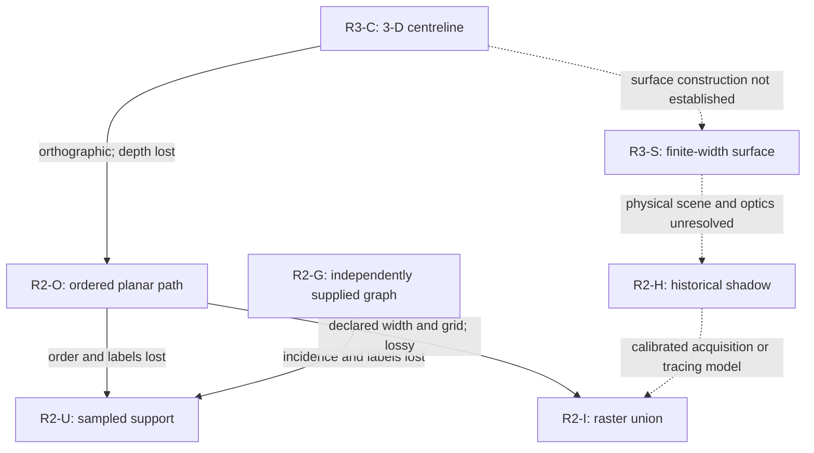

# P0A1 — Post-Synthetic Representation, Metric and Effective-Viewing-Capacity Methodology Qualification

**READ-ONLY REVIEW — PRE-QC / NOT FROZEN / NO FINAL APPROVAL**  
Date: 2026-10-15. Project: Meru Geometry Audit, v0.9 design line.

Authority: complete 286-line `docs/v0_9/p0a1_post_synthetic_methodology_qualification_protocol.md`, retrieved and read directly from the signed GitHub commit before conclusions. The handoff was read in full. M0–M8 were completed in order before an interruption; this delivered package reconstructs the completed review and discloses the recovery below.

## Proposed decision

[METHODOLOGICAL PROPOSAL] Submit for independent QC. Conditional non-target method routes survive; no primary Hebrew metric, target representation, global optimizer, exact G1/G2, source-constrained candidate or physical FIRST HAND shadow model is selected or finally qualified. `P0A1_METHODOLOGY_QUALIFIED_FOR_PRETARGET_DESIGN` is **NOT ASSIGNED**. Independent QC and a human signed decision freeze are required.

Proposed limited statuses coexist: `P0A1_REPRESENTATION_INSUFFICIENT` for missing target/physical-shadow observables; `P0A1_OPTIMIZATION_CERTIFICATION_DEFERRED`; `P0A1_EFFECTIVE_CAPACITY_NOT_SPECIFIED` for exact G1/G2/full numerical budgets; and `P0A1_SOURCE_CONSTRAINT_UNRESOLVED`. These preserve P0A0's engineering findings, not a blanket rejection of all metric families.

## M0 — Identity and frozen evidence

| Checkpoint | Verified commit | Verified immediate parent |
|---|---|---|
| P0A1 protocol | `5b0317f193c481d799e88b494ce370679fec43bc` | `5148712c07ac48742d3435dc14e01667280f94c3` |
| P0A0 results | `5148712c07ac48742d3435dc14e01667280f94c3` | `24c00fc44e4d9d57adacd1e636e9e2d20d86a954` |
| P0A0 implementation | `24c00fc44e4d9d57adacd1e636e9e2d20d86a954` | `d15865167b4e3c454e398bd498d9d681103096f7` |
| P0A0 protocol | `d15865167b4e3c454e398bd498d9d681103096f7` | `8bf0babfd91bdefb0792e93707fd0b0da1c09767` |

[FROZEN RESULT / PROVENANCE CHECK] All four signed Git objects were reconstructed from GitHub signature/payload and hashed to their exact commit SHA. GitHub reports valid signatures; local detached GPG verification of each returned 0 with signing and primary fingerprint `D4EC014EEFCC90E619D2AA59A91239ABCF512130`. Every recursive tree was reconstructed and hashed to its signed root. Eighteen retrieved text/metadata files hash to their signed blobs. P0A1 adds only its protocol; implementation/results freeze transitions are additive with no prior scientific blob modified. The provenance JSON records exact added paths.

P0A1 protocol blob: `d0a20485e8a2793fae6ede040fc266e461c8f23f`. P0A0 protocol blob: `0f8b663bfe2432685c9320a00c80fd6bcf436e38`, unchanged through all four checkpoints. Signed v0.8.0 tag object `12afd9f9d1cb4a9d000c0fd9555419f0383978e9` verifies locally with the same fingerprint and points to `85748bff0bfae383afcc0d885f4aec505a2885dd`. The pre-interruption local ancestry check returned 0; recovery GitHub comparison confirms that tag commit is the merge base/ancestor of pre-P0A0 parent `8bf0babfd91bdefb0792e93707fd0b0da1c09767`.

Remote branch `hebrew-projection-capacity-v0.9` was at the P0A1 commit in both observations. Before interruption, the pilot checkout was clean at `24c00fc44e4d9d57adacd1e636e9e2d20d86a954`; the original checkout remained at `d15865167b4e3c454e398bd498d9d681103096f7`, with 31 preexisting untracked implementation/report paths and empty tracked/staged diffs. Both had the named branch/upstream; both local origin-tracking refs were correspondingly older. These were disclosed, not updated. No pull/fetch/switch/reset/staging occurred. Pinned remote data supplied current authority.

Key setup limitations are explicit. The first session's default-keyring check returned NO_PUBKEY; isolated import returned 2 owing to gpg-agent startup although the public key was imported, followed by valid expected-key signatures. Recovery's isolated import similarly returned 2, then all four commits and the tag verified with exit 0. No trust elevation, alternate signer or bypass was used. The original P0A0 nonzero import caveat is a separate historical limitation, retained unchanged.

### Raw results and inherited qualifications

`reports/v0_9/p0a0_registered_execution/p0a0_registered_pilot_once.jsonl` is 12,052 bytes; SHA-256:

`4b4b27b0d5d9a95ffe864e2d2c83433be0ddd544b6122ebbea294857326817d6`

Read-only parsing preserves 14 records, one boundary header plus exactly S00–S12 in order, **5 PASS / 8 EXPECTED_BLIND_SPOT / 0 FAIL / 0 NOT_EVALUABLE**. The header binds implementation `24c00fc…` and manifest SHA `07a7e530f9bb3dc2005dc9ff5d158f95f1f6bc2b6fe7872d973e1a5198215fd0`. No numerical result was recomputed. The original execution ZIP hashes to:

`5c1b371ddaa2803430705a87f6cba748f3f3cd929749f596a55e1cd53a387295`

Recovery downloaded only that known synthetic execution archive and verified its hash and signed Git blob; no source image was downloaded or decoded.

Primary frozen evidence under `reports/v0_9/p0a0_registered_execution/`: `RESULTS_FREEZE_CLOSEOUT.md` §§1–5; `CASE_MATRIX.md`; `ENGINEERING_QC.md`; `P0A0_registered_execution_independent_QC_2026-10-15.md`; and `P0A0_registered_execution_independent_verification_2026-10-15.json`. Historical independent QC reports 42/42 read-only checks. This is not this agent claiming independent QC of its own P0A1 output.

Retain every qualification: 1,281 controlled regression passes with **two inherited image tests deselected**, not passed; earlier missing historical crop, not fetched/repaired; incomplete standalone DEV log (35 progress dots, no completion line, insufficient alone for the reported 59 passes); historical nonzero initial key-import exit; no proof that no other off-environment run ever existed; A09 raw absent in the registered workspace. A09 is metadata-only: unique A09/S06 row, JPEG/RGB, 826×787, 542620 recorded bytes and SHA `a091cbe95b9042cddb93bb5a57a07b406d5d1a6053e481faf2746b38a22dab68`. These CSV fields are not actual JPEG-byte validation.

### Interruption and document recovery

The original P0A1 review completed M0–M8 and built a 60,950-byte ZIP, with tool-recorded SHA `b2862f343a889fc058d005445674c0b45c2a7656cd0cc9c54896398d47e7e124`. It had not been persisted when the session interrupted. On continuation the workspace was reinitialized: the ZIP, inputs, scripts and both checkouts were absent. Two title searches found no matching retained P0A1 review archive. That earlier ZIP cannot be supplied or byte-verified now; **its checksum does not identify this delivered package**.

This package reconstitutes the completed methodology from visible prior authoring records, retaining the scientific contracts and proposed dispositions, with explicit recovery metadata. Exact prose byte identity to the lost output is not claimed. Pinned source bytes, signatures, tree identities and original P0A0 hashes were reverified solely to restore provenance, not to restart M0–M8 scientific analysis or rerun a case. No checkout was recreated or modified. Earlier local status/final-preservation assertions are labeled historical observations; recovery does not pretend absent repositories are freshly clean. This is an output-persistence limitation, not a changed frozen source identity. Independent QC should consider it explicitly.

## M1 — Seven representations and operators

The representation CSV has exactly R3-C, R3-S, R2-O, R2-U, R2-G, R2-I and R2-H, with fourteen populated fields per row. Observables, missing data, lossy conversion, valid source/target objects, groups, normalization, degeneracies and independent provenance/extraction obligations are explicit.

[MATH DERIVATION / METHODOLOGICAL PROPOSAL] Operator diagram; dotted arrows are unestablished or require additional models:

No inverse is licensed. Support does not recover stroke labels (JSONL S04), raster connectivity is not exact topology (S05), and centreline→ordered path→ink does not establish surface→physical shadow. A graph needs independently justified crossing/junction semantics. Finite samples are not a continuous curve. A09's hand drawing is not calibrated metric sculpture data (`docs/first_hand_source_recovery_ledger_v0.8.csv`, TA27).

## M2 — Complete method dispositions

All are proposed and claim-scoped; the method CSV supplies input/nuisance contracts, exact case evidence, independent-oracle scope, deterministic failures, eventual conditions, inferential limits and signing gate.

| Path | Primary proposed label | Principal reason |
|---|---|---|
| C1 ordered index Procrustes | REJECTED_FOR_CLAIMED_PURPOSE | Reject sampling-invariant/unlabeled claim, S03; preserve narrower supplied-correspondence diagnostics |
| C2 open arclength Procrustes | CONDITIONALLY_ADMISSIBLE | True order/endpoints plus interpolation/error bounds; S03 proves only its segment |
| C3 sampled Chamfer | CONDITIONALLY_ADMISSIBLE | Density/averaging and component/normalization limits, S04/S06–S08 |
| C4 sampled Hausdorff | CONDITIONALLY_ADMISSIBLE | Coverage/outlier limits, no continuous or graph certificate |
| C5 supplied-graph diagnostics | ADMISSIBLE_WITH_STATED_OBSERVABLES | Valid supplied incidence supports counts; target extraction remains conditional |
| C6 raster/silhouette | CONDITIONALLY_ADMISSIBLE | Fixed width/window/grid/threshold/uncertainty; no physical-shadow validation |
| C7 weighted composites | CONDITIONALLY_ADMISSIBLE | Independent term/weight/units and joint nuisance rationale; S06 1/4 is not a Hebrew constant |
| C8 actual 3-D shadow | NOT_ESTABLISHED | Historical geometry and optics missing; S00/S05 do not supply them |

Counts: five conditional, one admissible with stated observables, one rejected for its stated claim, one not established. A future suite could report support/graph/raster diagnostics separately if each contract is met; this review chooses no primary Hebrew metric or weight.

## M3–M6 — Formal methodological contracts

`symmetry_and_capacity_ledger.md` completes M3 and M5. It formalizes t+sQx with s>0 and Q∈SO(2), separate O(2), optional open reversal, genuinely closed-only cyclic shifts, explicit stroke/permutation/masking capacity, exact/near-tie rules and representation-specific nuisance actions. The inherited nonnegative-scale allowance and possible unattained positive-scale infimum remain a future gate, not a patch.

The n=Rᵀe_z proof and exact v0.5 frame table yield six signed G0 directions; three axes require the reflection quotient (JSONL S12). Roll is redundant under free SO(2). Object-specific symmetry is separate. Future nested G0⊆G1⊆G2 needs fixed groups/metric/physical model, actual distinct directions, coverage and solver certification. Actual G1/G2 remain unchosen. The minimum inequality requires nested full domains and attainment; otherwise use infima. Lower minima alone do not establish specificity.

`normalization_and_failure_ledger.md` completes M4: units, measures, arclength, centroid/RMS/scale, score signs/ranges, approximation/arithmetic/optimization uncertainty, components and threshold independence. It distinguishes INVALID_INPUT, NOT_EVALUABLE, finite degraded scores and missing metadata, zero/tiny extent, overlap, sparse components and pixel artifacts. Every proposed remedy names added freedom and future validation. S10's tiny-positive alignment rejection is retained.

`optimizer_certification_requirements.md` completes M6: JSONL S11 preserves local 0.4 versus analytic global 0. GLOBAL_CERTIFIED, BOUNDED_APPROXIMATION and LOCAL_ONLY require different proof. Multistart, a success flag or an unproved grid is not a global certificate. Every future family needs full continuous/discrete domain, oracle independence, error/tie/failure/runtime and discrepancy policy. No solver was run here.

## M7–M8 — Historical boundary and authority

`source_constraint_ledger.md` uses the exact five categories SOURCE_ATTESTED, SOURCE_CONSTRAINED_INTERPRETATION, INDEPENDENT_DIAGNOSTIC, NULL_CONTROL and UNRESOLVED. Located reciprocal rθ=1, later 1.5-turn span and three 120° copies are constraints, not missing functions or unique final geometry. Endpoint-reference/axis/mapping ambiguities, v0.8 missing shaping/carrier/physical-shadow law and N0–N3 future fairness prerequisites remain explicit. No model/null generator is selected or evaluated.

`next_gate_dependency_map.md` completes M8: independent QC/human freeze; source/rights/22-versus-27 extraction; independent second-chart uncertainty; exact methods/capacity; solver certification; candidate/control/confirmatory protocol; only then separately authorized target exposure/execution. The 22 letters are a fixed corpus, not IID replicates. Candidate×capacity interaction, per-letter coherence, Monte Carlo precision/sensitivity, detectability and multiplicity require future signed design. No p-values or power result are claimed.

## Field dictionary

CSV is UTF-8 with headers and exactly one row per declared ID. All cells are explicit text; NOT_ESTABLISHED denotes insufficient evidence and UNRESOLVED a missing fact or future decision. References are pinned repository paths/case/section/row IDs. Primary method `disposition` uses only four frozen labels; `alternative_scoped_disposition` addresses a distinct narrower/broader claim, not silent promotion of the primary label.

| Representation fields | Interpretation |
|---|---|
| representation_id; definition | Unique type and observational/mathematical definition |
| observable_fields; unavailable_data | Supplied independent information versus missing/unidentifiable fields |
| forward_loss | Information removed by declared conversions; no inverse implied |
| permissible_source; permissible_target | Compatible objects, still subject to later authority |
| nuisance_group | Proposed transforms and separately counted search choices |
| normalization_obligations; degeneracies | Measure/units/domain requirements and numeric/epistemic failures |
| metadata_requirements | Independent provenance, calibration, annotation and uncertainty |
| source_supply_status; new_extraction_required | What frozen evidence really supplies and need for later licensed extraction/model authority |
| evidence | Exact frozen source support |

| Method fields | Interpretation |
|---|---|
| path_id; method; assessed_claim | Unique C1–C8 family and precise claim classified |
| disposition | Proposed frozen-vocabulary label pending independent QC |
| input_contract; allowed_nuisance_group | Minimum observable/valid-domain and fitting permission |
| p0a0_evidence; independent_oracle_scope | Exact case support and what its independent reference does/does not certify |
| failure_state; observable_failure_modes | Proposed deterministic handling and retained pathology/observability limits |
| eventual_use_conditions; inferential_limits | Preconditions and prohibited extrapolations |
| next_gate; alternative_scoped_disposition | Later signing/validation authority and treatment of a different scoped claim |

## Evidence labels, assumptions and conduct

Narrative distinguishes [FROZEN RESULT], [SOURCE-ATTESTED], [MATH DERIVATION], [METHODOLOGICAL PROPOSAL], [UNRESOLVED/REQUIRES LATER GATE]. The source ledger's underscore categories are its separate mandatory taxonomy. Matrix/future-contract statements are proposals unless explicitly described as frozen observations. Numeric P0A0 statements cite the immutable JSONL/case or exact frozen configuration; none is a fresh result.

Assumptions: expected-key signatures are the authorized trust anchor; historical source closeout is a bounded-corpus result; group/optical equivalences require stated hypotheses; supplied metadata must be independently justified, not fitted to targets; no unobserved shape feature is assumed. Missing hypotheses block the associated claim.

The provenance JSON contains recovered and current source verification, prior local states labeled historical, interruption disclosure, input/access scope and action ledger. **NO_HEBREW_TARGET_ANALYSIS_PERFORMED; NO_NEW_P0A0_EXECUTION; NO_SCIENTIFIC_CANDIDATE_NULL_TEST; NO_AGENT_GIT_WRITES; NO_NEW_NUMERICAL_EXPERIMENT.** These describe observed actions and records, not exhaustive host history. No original source image, glyph/font proxy, target coordinates or source-derived trace entered the review. All authoring occurred outside repositories. Python was used only for formatting, parsing, hashing, signature/tree bookkeeping and ZIP validation.

Ten report files plus root README, inventory and checksum manifest form the complete package. The auditor checklist remains unfilled. Archive checks establish packaging integrity, not scientific approval, qualification freeze or permission for downstream target access.
